<p align="center">
  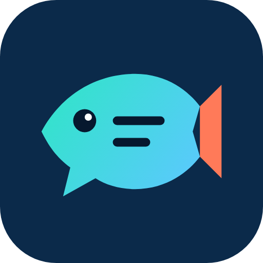
</p>

<h1 align="center">EngFish 🐟</h1>

<p align="center">
  An English-learning Android app for Turkish speakers — vocabulary cards, podcasts, translation, speaking and writing practice, with daily streaks and collectible characters.
</p>

<p align="center">
  
  
  
  
</p>

---

## Screenshots

| Sentences | Smart Cards | Card |
|:---:|:---:|:---:|
| 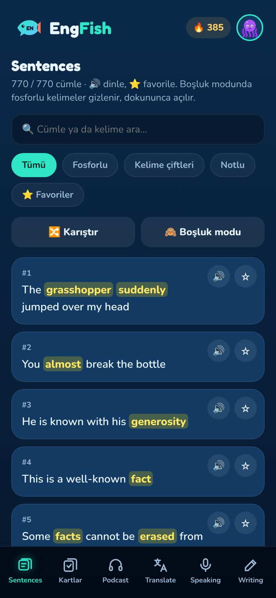 | 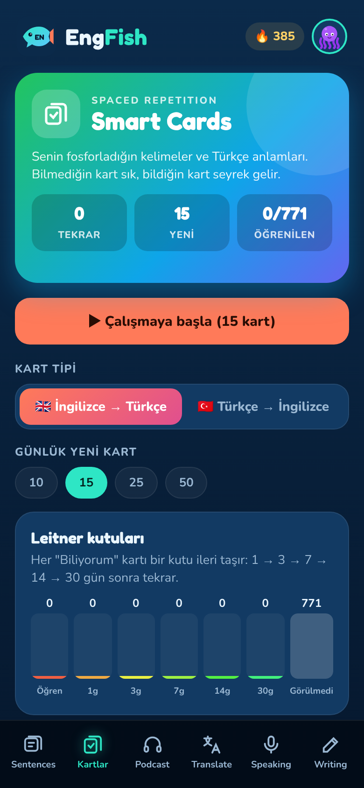 | 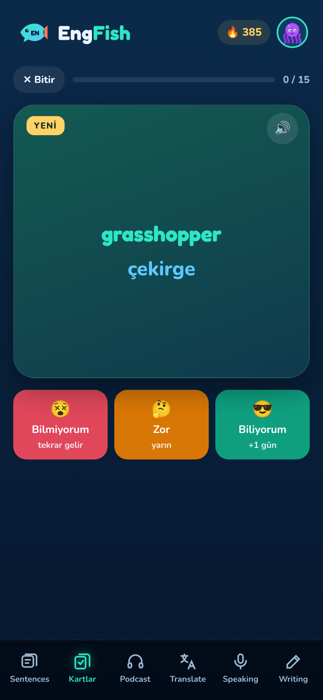 |

| Podcast | Translate | Speaking |
|:---:|:---:|:---:|
| 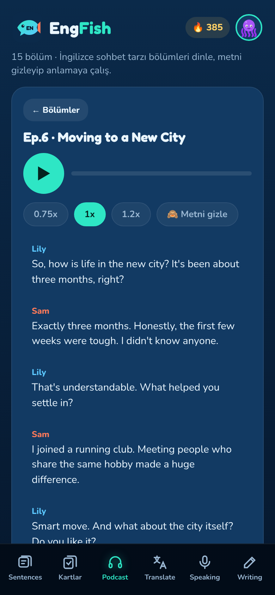 | 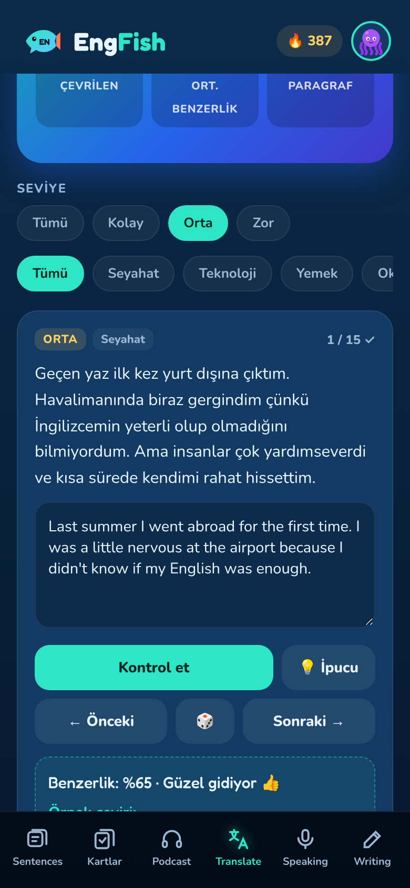 | 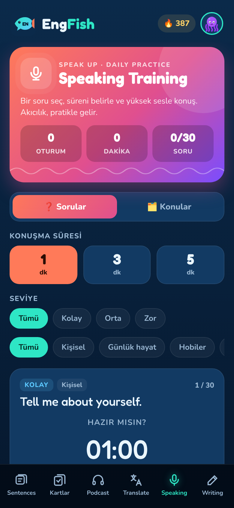 |

| Speaking topics | Writing | Profile & streak |
|:---:|:---:|:---:|
| 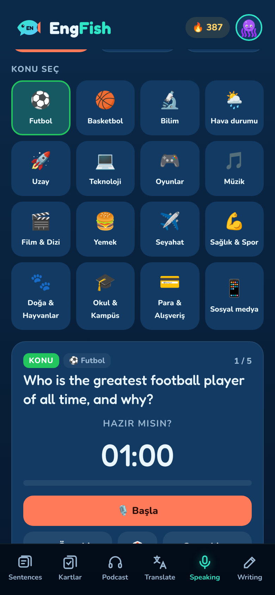 | 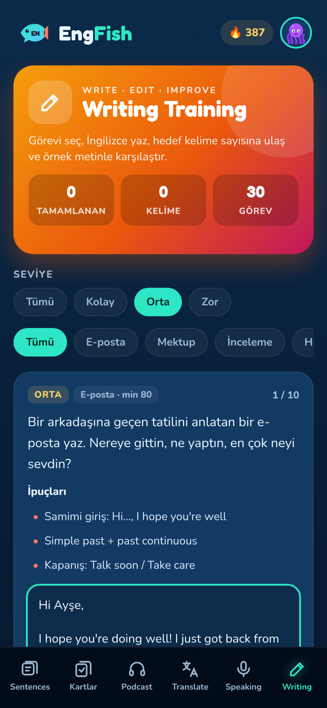 | 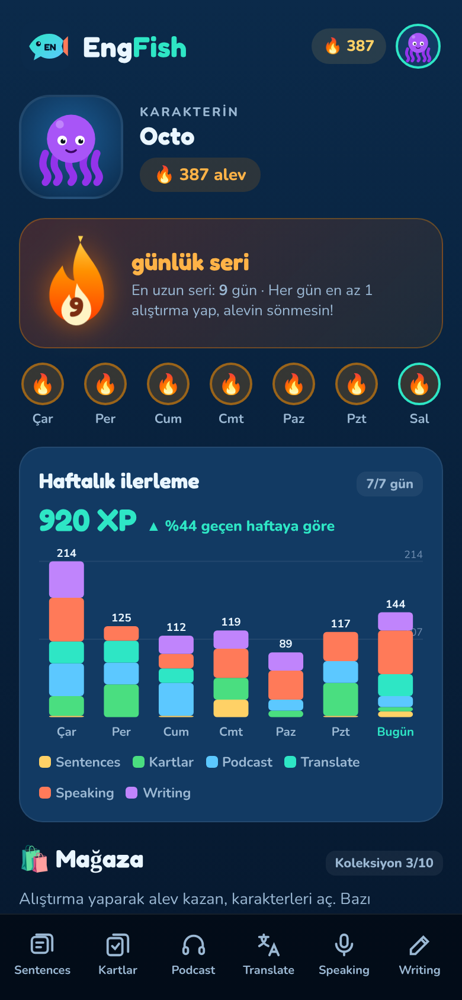 |

| Shop |
|:---:|
| 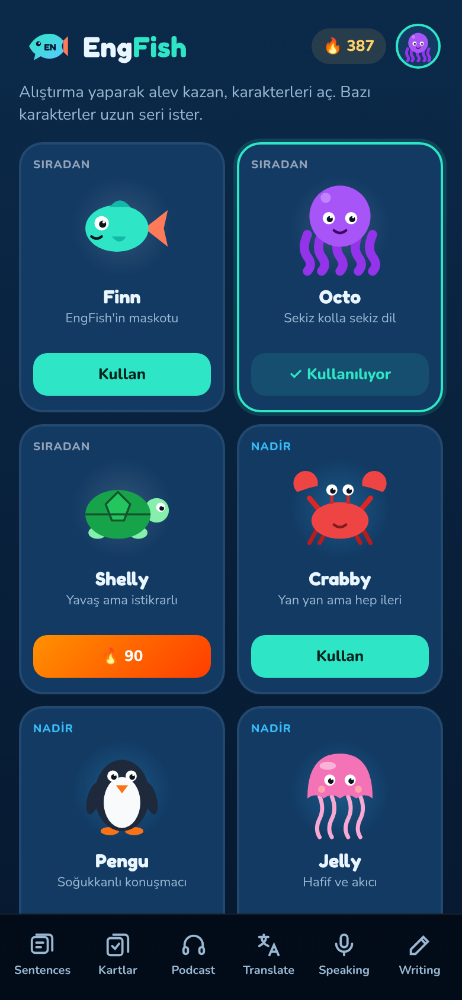 |

---

## Features

### 📝 Sentences — 770 personal example sentences
- Highlighted key words (imported from Obsidian `==highlight==` notes), personal notes and word pairs
- Search, filters (highlighted / word pairs / with notes / favourites), shuffle
- **Gap mode:** highlighted words are blurred — tap to reveal
- Text-to-speech for every sentence, favourites

### 🃏 Smart Cards — spaced repetition (Leitner system)
- 771 cards generated from the highlighted words, each with a Turkish meaning
- Two directions: **English → Turkish** and **Turkish → English**
- *Don't know* → comes back in the same session · *Hard* → tomorrow · *Know it* → next box (1 → 3 → 7 → 14 → 30 days)
- Daily new-card limit (10 / 15 / 25 / 50), Leitner box overview
- Misspelled words from the notes are shown in their correct form

### 🎧 Podcast — 15 dialogue episodes
- 5 easy, 5 intermediate, 5 advanced episodes with two speakers
- Line-by-line highlighting, speed control (0.75× / 1× / 1.2×), *hide transcript* mode

### 🔤 Translate — 45 Turkish paragraphs
- Easy / intermediate / hard, 17 topics
- Similarity score against a model translation, hints, listen to the model answer

### 🎙️ Speaking — 110 prompts
- **Questions mode:** 30 questions in 9 categories and 3 levels
- **Topics mode:** 16 topics (football, basketball, science, weather, space, technology, games, music, films, food, travel, health, nature, campus, money, social media), each with 5 questions and 10 key words
- Speaking timer: 1 / 3 / 5 minutes with 15 s preparation
- Useful phrases, talking points and sample answers (with audio)

### ✍️ Writing — 30 tasks
- 12 types: e-mail, letter, message, diary, description, introduction, opinion, story, review, essay, report, cover letter
- Word-count goal with progress bar, tips, checklist and model text

### 🔥 Streaks, progress & shop
- Real daily streak with a 7-day calendar and best streak
- Weekly progress chart (XP per day, split by section) compared with the previous week
- Earn **flames** by practising and unlock **10 original sea characters** (some need a 7, 14 or 30-day streak)

---

## Tech

EngFish is a **hybrid app**: the UI is a single HTML/CSS/JavaScript app in `app/src/main/assets/www`, hosted in a native Kotlin `WebView`.

| Part | Details |
|---|---|
| Native shell | Kotlin, `ComponentActivity`, `WebView` |
| Asset loading | `androidx.webkit.WebViewAssetLoader` (stable `https://appassets.androidplatform.net` origin, so progress is kept) |
| Speech | Android native `TextToSpeech` exposed to JS through a `@JavascriptInterface` bridge (`TtsBridge.kt`) |
| Storage | `localStorage` (streak, flames, cards, favourites, drafts) |
| Fonts | Fredoka & Nunito bundled offline (SIL OFL) |
| Back button | Closes the open card session, podcast player or returns to the first tab |

The app works fully offline.

```
EngFish/
├── app/
│   ├── src/main/
│   │   ├── assets/www/        # Web UI (index.html + fonts)
│   │   ├── java/com/muba14/engfish/
│   │   │   ├── MainActivity.kt
│   │   │   └── TtsBridge.kt
│   │   ├── res/               # Icons, theme
│   │   └── AndroidManifest.xml
│   └── build.gradle.kts
├── docs/                      # Same app for the web (GitHub Pages)
├── screenshots/
└── .github/workflows/android.yml
```

---

## Build & run

**Android Studio**
1. Clone the repo: `git clone https://github.com/muba14/EngFish.git`
2. Open the folder in Android Studio (Ladybug or newer) and let Gradle sync.
3. Run ▶ on a device or emulator (Android 7.0+).

**Command line**
```bash
./gradlew assembleDebug
# APK: app/build/outputs/apk/debug/app-debug.apk
```

**GitHub Actions** — every push to `main` builds a debug APK. Download it from the **Actions** tab → latest run → *Artifacts*.

> 💡 For podcast audio, the phone needs an English text-to-speech voice (Settings → Accessibility → Text-to-speech, e.g. *Speech Services by Google*).

**Web version** — `docs/index.html` runs in any browser. Enable GitHub Pages (Settings → Pages → *Deploy from branch* → `main` / `docs`) to get a live demo.

---

## Roadmap
- [ ] Grammar corner (since/for/by/until, conditionals, wish, used to …) with mini tests
- [ ] "Today" screen with a daily mix and reminder notifications
- [ ] Streak freeze & character accessories in the shop
- [ ] Speech recording with transcription and pronunciation feedback
- [ ] Podcast comprehension questions and dictation mode

---

## License
[MIT](LICENSE) © muba14
